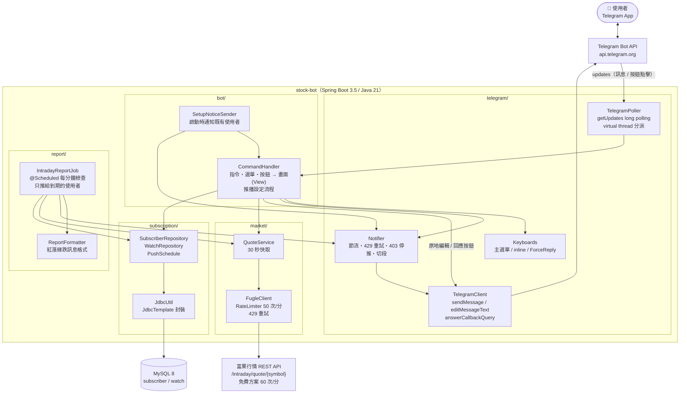
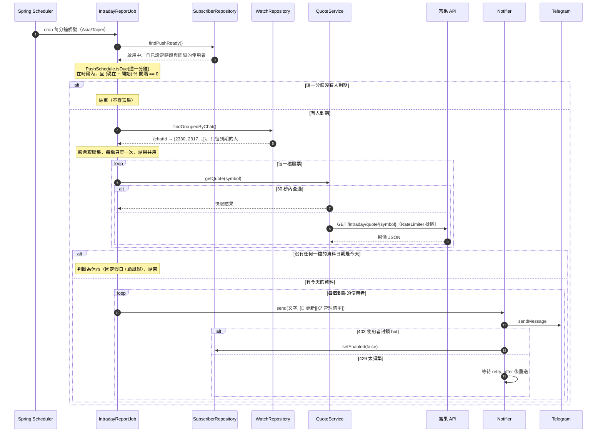
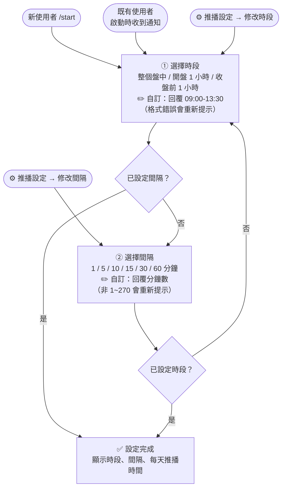
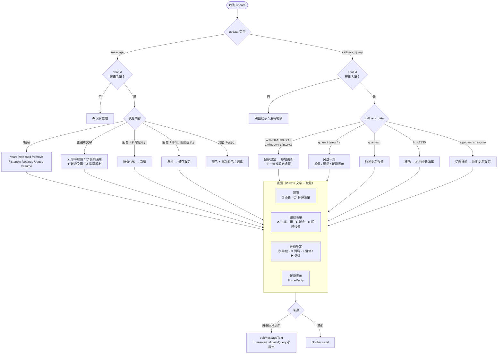
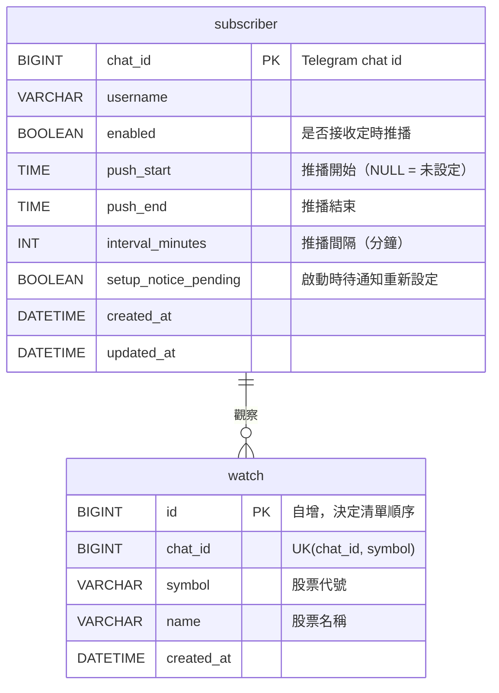

# stock-bot 架構與流程

## 1. 整體架構

單一 Spring Boot 服務，對外只連三個東西：Telegram Bot API、富果行情 REST API、MySQL。
Telegram 用 long polling 收訊息，所以不需要公網 IP 或 HTTPS 網域。

## 2. 定時推播流程

交易日 09:00 ~ 13:59 每分鐘觸發一次；每位使用者依自己設定的時段與間隔決定這一分鐘要不要推。
例如 `09:05–10:00、每 20 分鐘` → 09:05、09:25、09:45 會推，其他分鐘不推。

### 推播設定流程

新使用者 `/start` 後、既有使用者在服務升級後收到通知時，都會進入兩步驟設定；兩步都完成才開始推播。

## 3. 使用者互動流程

三種輸入（斜線指令、主選單按鈕、inline 按鈕）最後都落到同一組畫面：報價、清單、設定、新增提示。

## 4. 資料表

