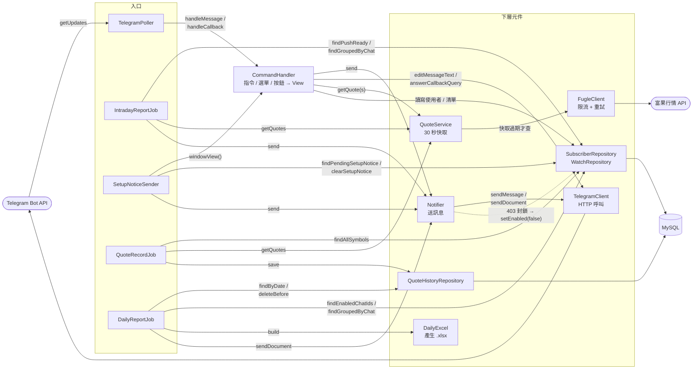
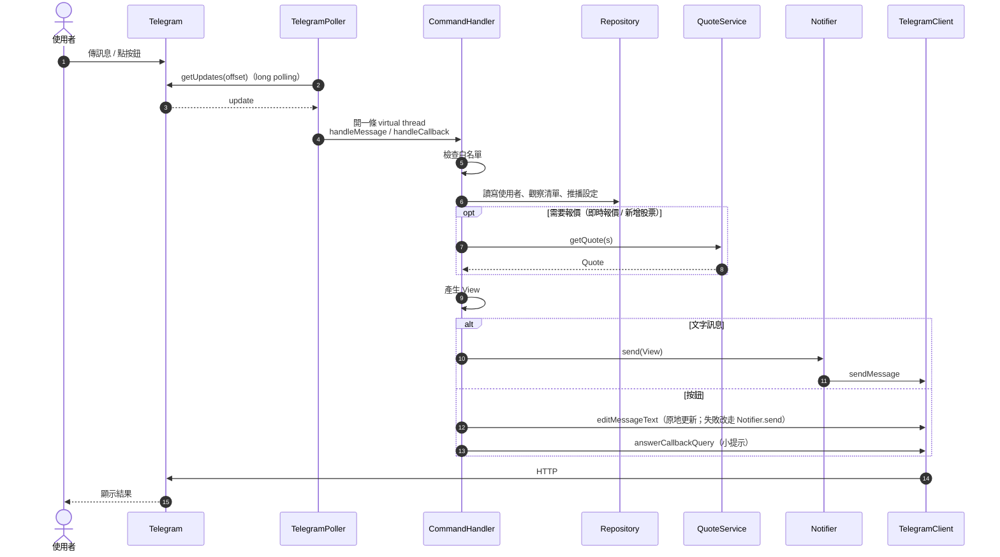
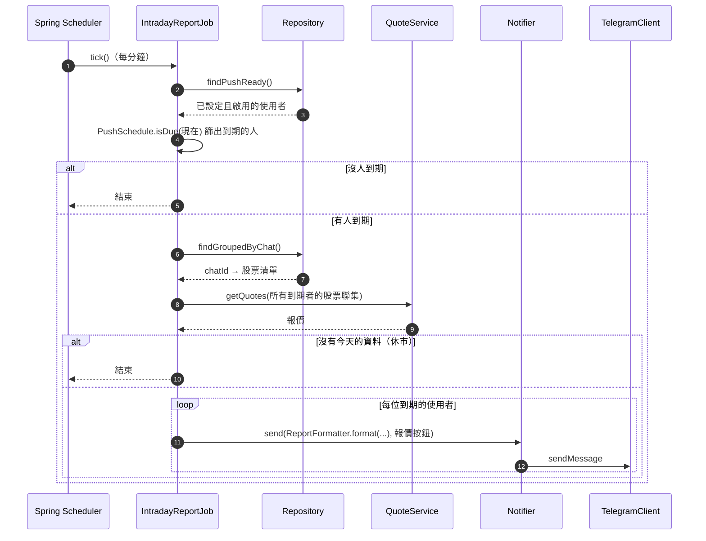
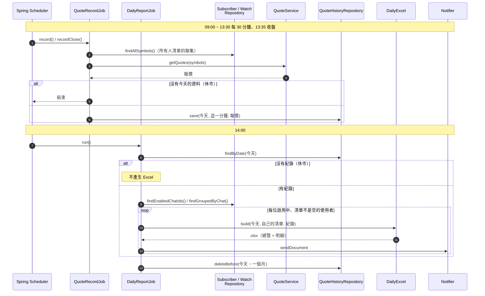
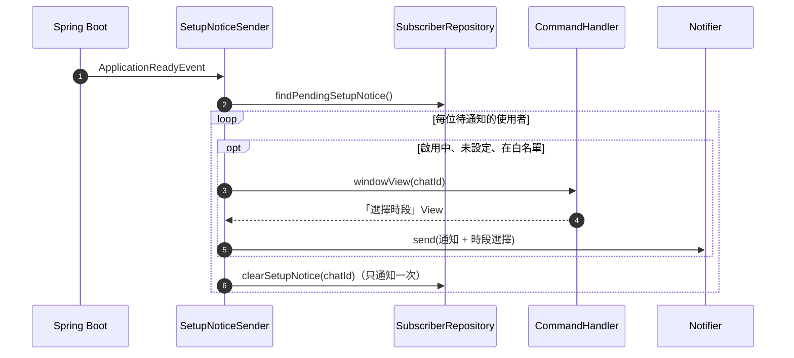
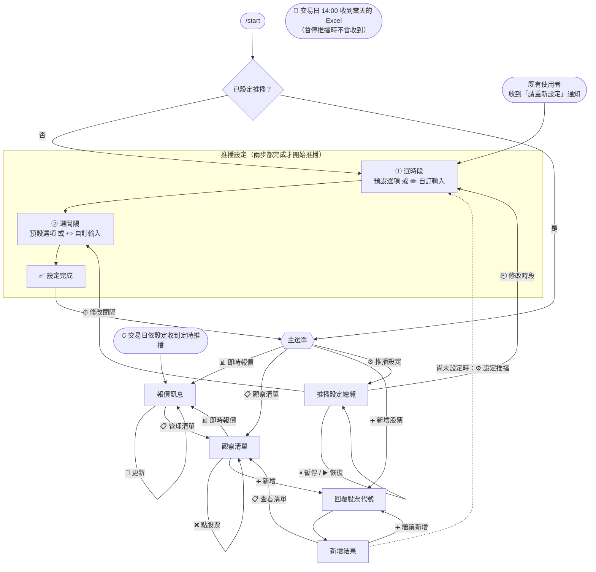

# stock-bot 流程圖

只記錄兩件事：**程式之間怎麼互相呼叫**、**使用者怎麼操作**。
欄位、設定值等細節請看 README 與程式碼。

## 1. 程式交互

### 1.1 元件關係

程式有三個入口，最後都經過同一組下層元件：

| 入口 | 觸發時機 | 執行緒 |
|---|---|---|
| `TelegramPoller` | 使用者傳訊息 / 點按鈕 | `telegram-poller` 收訊，`tg-update-N` 處理 |
| `IntradayReportJob` | 排程每分鐘一次（交易日盤中） | `push-job-N` |
| `QuoteRecordJob` | 排程 09:00 ~ 13:30 每 30 分鐘，以及 13:35 收盤 | `push-job-N` |
| `DailyReportJob` | 排程每天 14:00（交易日） | `push-job-N` |
| `SetupNoticeSender` | 服務啟動完成（`ApplicationReadyEvent`） | `setup-notice` |

### 1.2 使用者操作的處理路徑

`CommandHandler` 每次都先算出一個 **View（文字 + 按鈕）**，再決定怎麼送出：
文字訊息一律送新訊息；按鈕大多原地編輯原訊息，最後一定回 `answerCallbackQuery`。

### 1.3 定時推播

### 1.4 報價紀錄與每日 Excel

### 1.5 啟動時通知既有使用者

## 2. 使用者操作流程

> 修改時段或間隔時，若另一項已設定，存完就直接回到設定總覽，不會再走下一步。
> 斜線指令（`/now` `/list` `/add` `/settings` `/pause` `/resume`）對應到上圖同一組畫面。
